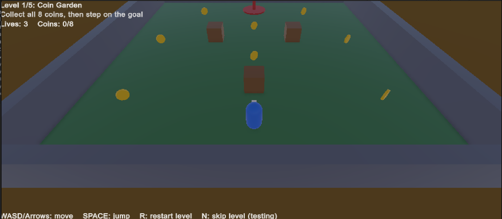
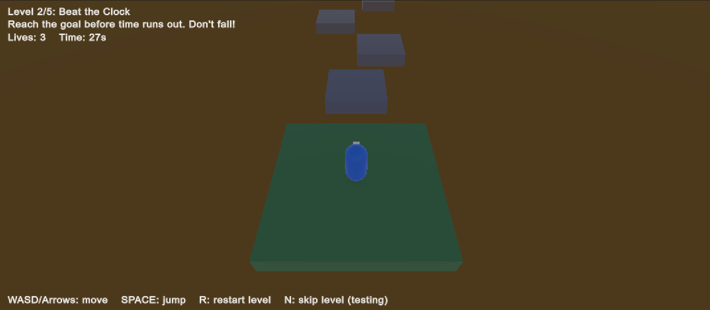
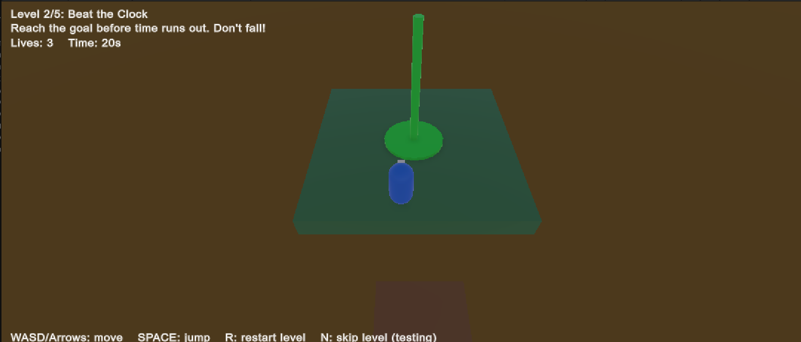
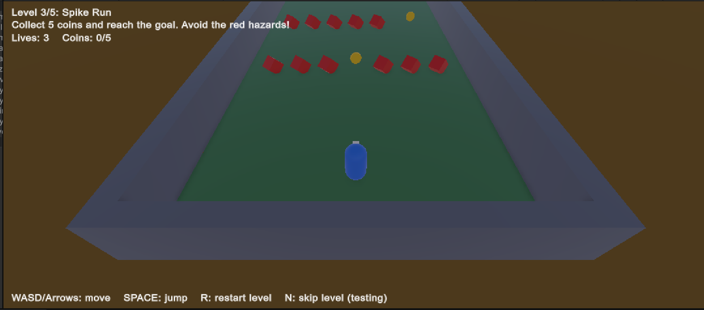
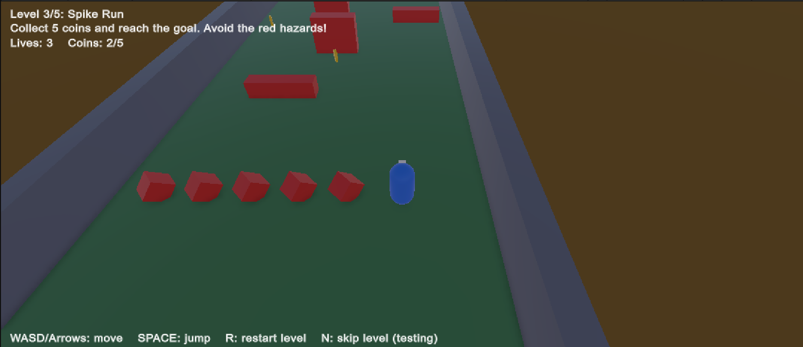
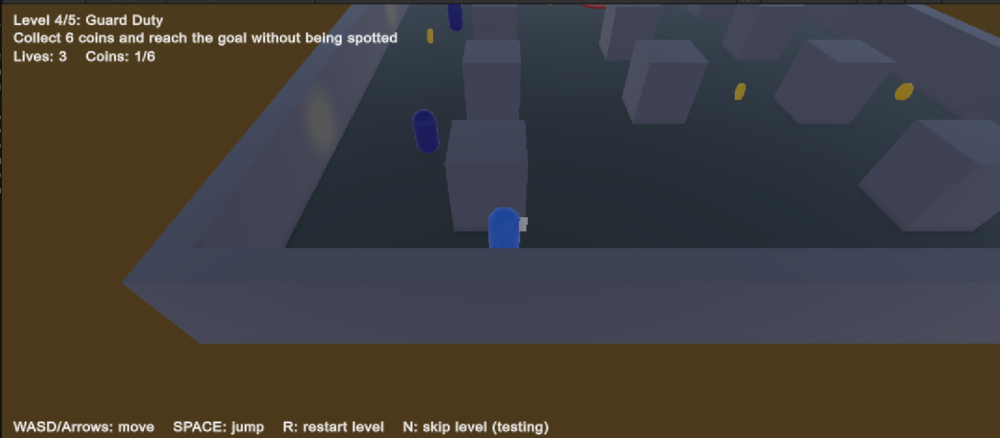
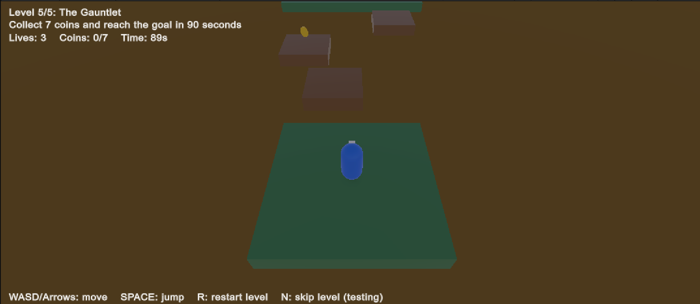
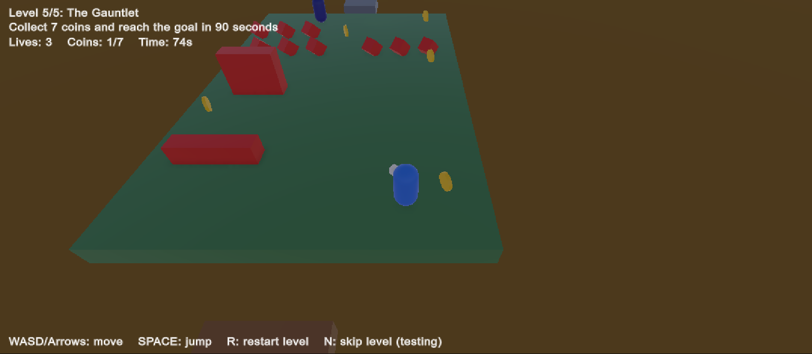
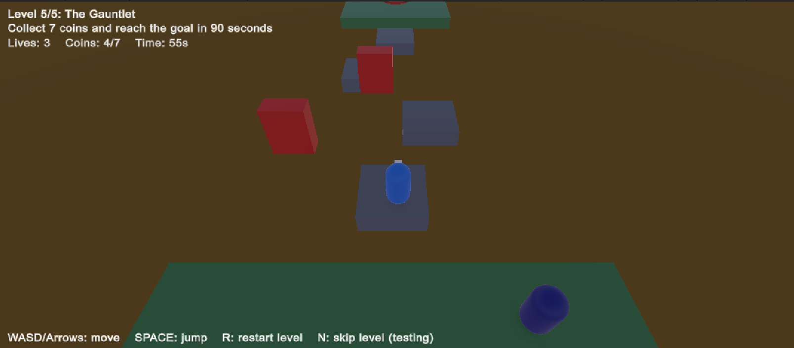

# ITU-CS-464-LAB-06-<ROLL NUMBER> — 3D 5-Level Game (Unity)

A 3D third-person action/puzzle game built in Unity. Across five levels you control a character, collect coins, dodge hazards, avoid guards, beat the clock and reach the goal.

**Author:** <Your Name> (<Roll Number>) — ITU, CS-464 Lab 06
**Unity version:** <e.g. 2022.3 LTS / Unity 6>

## Controls

| Key | Action |
|-----|--------|
| WASD / Arrow keys | Move |
| SPACE | Jump (also confirms menus) |
| R | Restart current level |
| N | Skip to next level (testing) |

## Levels

| # | Name | Objective | Mechanics |
|---|------|-----------|-----------|
| 1 | Coin Garden | Collect 8 coins, then reach the goal | Open field, no hazards; teaches movement |
| 2 | Beat the Clock | Reach the goal in 32 seconds | Precision jumps across platforms with growing gaps; falling costs a life |
| 3 | Spike Run | Collect 5 coins, then reach the goal | Static spikes and sweeping hazard bars that need careful timing |
| 4 | Guard Duty | Collect 6 coins without being spotted | Patrolling guards with vision cones, cover pillars |
| 5 | The Gauntlet | Collect 7 coins in 90 seconds | Moving platforms, sweepers, spikes, a guard and a strict timer |

Difficulty rises each level: more hazard types, tighter timing and combined mechanics.

## Screenshots

### Level 1: Coin Garden

### Level 2: Beat the Clock

### Level 3: Spike Run

### Level 4: Guard Duty

### Level 5: The Gauntlet

## Game rules
- You get **3 lives per level**. Falling, touching a hazard, being spotted by a guard or running out of time costs a life.
- The goal stays **red (locked)** and turns **green** once you have collected the required coins.
- Retrying after a death rebuilds the level; clearing a level resets lives for the next one.

## Beyond the lecture
- Five different objective types instead of one example level.
- **Guard AI:** vision cone (range + angle) with a line-of-sight raycast, so pillars block sight; guards also catch you if you get too close.
- **Moving platforms** carry the player by applying each platform's per-frame movement.
- **Game state machine** (intro, playing, dead, level complete, game over, win) with lives, a countdown timer and an on-screen HUD.
- **Code-built levels:** all layouts are generated from Unity primitives in one data-driven script, so levels are easy to add or tune.
- Works with both Unity input systems.

## Project structure (`Assets`)
- `GameManager` — game state, lives, timer, HUD; starts itself on Play
- `LevelBuilder` — builds all 5 levels
- `PlayerController` — movement, gravity, jumping, riding platforms, fall detection
- `CameraFollow` — smooth third-person follow camera
- `Mover` — back-and-forth movement for platforms, sweepers and coins
- `Hazard` — kills the player on touch (spikes, sweepers)
- `Collectible` — coin pickup
- `GoalZone` — goal trigger, locked until enough coins are collected
- `Guard` — patrol route and vision-cone detection
- `GameInput` — keyboard input wrapper